# System Architecture — Personal AI Memory Assistant (Dual Android Device)

## 1. Overview
The system splits responsibility across two independent Android applications sharing a strongly typed protocol library:

- **`recorder-app` (Device B):** Dedicated secondary Android phone (no SIM required) running continuous Voice Activity Detection (Silero VAD) inside an explicitly user-armed `microphone` foreground service (`RecorderService`), storing encrypted WAV segments locally in app-private storage, and serving a BLE GATT + L2CAP CoC peripheral interface.
- **`primary-app` (Device A):** Primary Android smartphone controlling an already-running Device B recorder, synchronizing missing segments/metadata, performing 100% offline ASR (English & Hindi via Android On-Device Speech SODA or loopback Whisper), extracting structured memories/tasks/summaries via Universal Offline AI Provider (`com.uoai.provider`, Gemma 3/4 on `127.0.0.1:8765`), and answering user queries strictly grounded in local transcript sources (zero cloud AI).
- **`shared-protocol`:** Pure Kotlin module defining protocol versions, state enums, commands, binary envelopes, chunk framing, HMAC signing, and replay protection contracts.

## 2. Core Architectural Invariants
1. **Bluetooth-Independent Recording:** Device B's `RecorderService` and audio/VAD/storage pipeline never depend on BLE connection state. Disconnecting Device A keeps Device B recording locally.
2. **Decoupled State Machines:** `RecorderState` (microphone & storage lifecycle) and `BleConnectionState` (transport & sync lifecycle) are tracked independently.
3. **Zero Silent Background Mic Activation:** Android 12–16 rules prohibit starting `microphone` foreground services from background BLE callbacks or `BOOT_COMPLETED`. Device B must be visibly armed by user action; remote `START_RECORDING` operates on an already-authorized service or returns `ERR_SERVICE_NOT_RUNNING` / `ERR_USER_INTERACTION_REQUIRED`.
4. **Encrypt-Before-Persist:** Speech segments are wrapped in WAV headers and AES-256-GCM encrypted using Android Keystore before persistent storage.
5. **Preserve Until Verified:** Audio segments are never deleted when ASR fails or sync attempts fail; deletion only follows checksum-verified `SYNC_ACK` and explicit retention policy.

## 3. Architecture Diagrams

```mermaid
flowchart LR
  subgraph DeviceB["Device B: recorder-app"]
    B_UI["Compose Setup, Status & Emergency Stop UI"]
    B_REC["RecorderService (microphone FGS)"]
    B_AUD["AudioCaptureEngine + AudioRecordingCallback"]
    B_VAD["SileroOnnxVadEngine (16 kHz / 512 samples)"]
    B_SEG["SpeechSegmenter + Keystore AES-256-GCM"]
    B_DB["Room DB (Sessions, Segments, SyncQueue, Diagnostics)"]
    B_BLE["BlePeripheralHost (GATT + L2CAP CoC)"]
  end

  subgraph Shared["shared-protocol"]
    P_STATE["RecorderState & BleConnectionState"]
    P_ENV["Versioned Binary Envelope + HMAC Auth"]
  end

  subgraph DeviceA["Device A: primary-app"]
    A_BLE["BleClientController (GATT + L2CAP CoC)"]
    A_SYNC["Incremental Sync & Checksum Verifier"]
    A_ASR["AsrProvider (On-Device Speech / Loopback Whisper)"]
    A_MEM["UoaiLlmProvider (com.uoai.provider 127.0.0.1:8765) + Offline Fallback"]
    A_SEARCH["Room FTS4 + Local Vector Index"]
    A_UI["Compose UI (14 Screens)"]
  end

  B_UI --> B_REC
  B_REC --> B_AUD --> B_VAD --> B_SEG --> B_DB
  B_REC <--> B_BLE
  B_DB <--> B_BLE
  B_BLE <-. "BLE Control + L2CAP CoC Audio" .-> A_BLE
  Shared --- B_BLE
  Shared --- A_BLE
  A_BLE --> A_SYNC --> A_ASR --> A_MEM --> A_SEARCH --> A_UI
```

